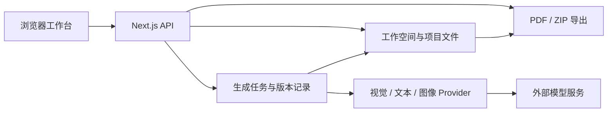

# FABRIQ — Fabric-to-Fashion Agent

**从面料图片到系列成衣设计提案的 AI 创作工作室。** 面向服装设计师、独立品牌、服装工厂和 ODM 设计团队，将面料素材、设计参数、生成任务、成衣图与提案关联到同一个项目，支持创意探索和客户方案沟通。

项目目录与 npm 包名称为 `fabric-to-fashion`。当前版本是可本地运行、可独立部署的工作室 MVP，提供明确标注的 Demo 模式和可配置的真实模型接入。它不包含商城、ERP、打样管理、3D 仿真、商业计费或完整的多租户账户体系。

## 核心功能

| 模块           | 已实现的能力                                                                                                               |
| -------------- | -------------------------------------------------------------------------------------------------------------------------- |
| 素材与面料档案 | 每项目最多 6 张面料／参考图；支持 JPG、PNG、WebP；保留原始素材；分析可见颜色、纹理、图案、视觉质感和适用品类，允许人工修订 |
| 设计方向       | 女装／男装／童装、多种款式、七种设计风格、春夏／秋冬、商业成衣／创意探索、4／6／8 款、三种图片比例与自然语言要求           |
| 系列创作       | 主题、理念、灵感、关键词、款式规划与成衣图；串行任务进度、失败提示、未完成款式重试                                         |
| 单款调整       | 放大预览、修改名称与说明、原图加文字指令重新生成、历史版本预览                                                             |
| 方案交付       | 系列提案页面、内嵌中文字体的横向 A4 PDF、单图下载、图片及设计清单 ZIP                                                      |
| 项目记录       | 持久化保存、搜索、收藏、继续设计与删除；保留生成时的素材、分析和参数快照                                                   |
| 模型设置       | 视觉／文本与图像模型独立配置 Provider、Base URL、模型名称、API Key；连接测试与密钥清除                                     |

### Demo 与真实生成

- **Demo（默认）**：无需 API Key，使用预设人字纹面料分析和八款静奢女装图片演示完整流程。上传图片、品类、风格、比例或修改指令**不会改变预置效果图**，分析也不是对上传图片的真实识别。界面、任务、PDF 和 ZIP 均标注示例来源。
- **真实生成**：在 `/settings` 配置两类模型并切换模式，才会调用外部服务。支持 Gemini 原生、OpenAI 兼容协议，以及 Seedream 图像接口。真实请求失败不会自动退回 Demo。
- 示例图的生成记录见 [docs/demo-assets.json](docs/demo-assets.json)。本地 HTTP mock 已覆盖 Provider 协议；**尚未使用真实付费 API Key 验证云端生图**，具体模型、代理服务与账户权限需自行验证。接入细节见 [模型与 API 文档](docs/API.md)。

## 技术架构

| 层级       | 实际实现                                                              |
| ---------- | --------------------------------------------------------------------- |
| Web 与 API | Next.js 16.4.3 App Router、React 19.3、TypeScript 严格模式            |
| 界面       | 定制响应式 CSS、Lucide 图标、本地 Manrope／Noto 字体；未使用 Tailwind |
| 数据约束   | Zod 校验输入与模型结构化输出                                          |
| 素材处理   | Sharp 图片校验、旋转、缩放及规范化                                    |
| 存储       | 服务端文件系统、JSON 原子写入、进程内项目锁；无外部数据库             |
| 任务       | Next.js `after()` 与单个常驻 Node.js 进程，状态持续落盘               |
| 输出       | PDFKit 生成中文 PDF，Archiver 打包 ZIP                                |
| 验证       | Node.js Test Runner + tsx 的协议测试，Playwright 端到端测试           |



```text
fabric-to-fashion/
├── src/
│   ├── app/                    页面入口、全站样式、图标与 API 路由
│   │   └── api/                项目、上传、分析、生成、导出、素材和设置接口
│   ├── components/             创作工作台、模型设置和提案视图
│   ├── lib/
│   │   ├── types.ts            Zod 约束与共享类型
│   │   ├── demo.ts             明确标注的示例分析与系列
│   │   └── server/
│   │       ├── store.ts        会话空间、加密设置、项目及素材存储
│   │       ├── providers.ts    多模态和图像服务适配
│   │       ├── jobs.ts         任务、重试、版本和中断恢复
│   │       ├── http.ts         请求校验、错误响应和基础限流
│   │       └── pdf.ts          中文设计提案排版
│   └── proxy.ts                可选工作室访问密码
├── public/demo/                一块示例面料与八款预置成衣图
├── public/fonts/               网页与 PDF 字体及原始许可证
├── tests/                      Provider 测试与端到端工作流
├── docs/                       API、验收和许可审核文档
├── .env.example                不含真实密钥的配置模板
├── package-lock.json           npm 锁定依赖
└── .data/                      运行时私有数据（自动创建，不提交）
```

## 快速开始

### 环境要求

- 推荐 Node.js 22.12 或更高的 22.x 版本；当前验收环境为 Node.js 22.23.1、npm 10.9.8。
- npm、Git，以及应用可写的持久磁盘。无需数据库、Redis、对象存储或 Docker。
- 私有仓库仅对获得访问权限的 GitHub 账户开放，SSH 克隆需要对应账户的 SSH Key。

```bash
git clone git@github.com:bingyue/fabric-to-fashion.git
cd fabric-to-fashion
npm ci
cp .env.example .env.local
npm run dev
```

访问 <http://127.0.0.1:3018>。默认即可使用 Demo；开发服务器只监听本机。已有 `.env.local` 时保留原文件，不要重复覆盖。Windows 用户可在 Git Bash／WSL 运行上述命令；现有端到端测试启动命令使用 POSIX 环境变量语法。

### 完整操作示例

1. 首页点击“开启我的创作”，上传面料，或点击“使用燕麦色人字纹示例”。
2. 点击“分析面料”，确认当前是 Demo 预设分析或真实模型分析；可编辑面料档案。
3. 进入“设计方向”，选择款式、风格、季节、数量和比例。例如：女装、极简主义、秋冬、6 款，并填写“保留人字纹面料，用于商务通勤，线条简洁”。
4. 点击“生成系列”，查看每款进度与设计说明。刷新页面后可继续查看任务和结果。
5. 打开单款，修改说明，或提交“收窄领口，保持面料颜色”等调整要求。Demo 只演示版本流程，不改变图片。
6. 点击“下载图片”获取 ZIP，或进入“设计提案”导出 PDF。在“我的项目”中搜索、收藏并继续设计。

命令行验证服务是否运行：

```bash
curl -I http://127.0.0.1:3018/
curl -fsS http://127.0.0.1:3018/api/settings
```

第二条返回当前请求空间的模式和配置摘要，不包含明文 Key；它不会读取浏览器中的工作空间。启用访问密码后，使用 `curl -u studio` 交互输入密码，再加相同 URL。写入接口与 Cookie 的使用方式见 [API 文档](docs/API.md)。

## 配置说明

将 `.env.example` 复制为 `.env.local`，修改后重启服务。模板不包含真实凭据。

| 环境变量                  | 默认行为                                          | 配置用途                                                                      |
| ------------------------- | ------------------------------------------------- | ----------------------------------------------------------------------------- |
| `FABRIC_DATA_DIR`         | `.data`，相对于启动目录                           | 项目、图片、加密配置与本地主密钥的持久目录；生产环境建议使用固定绝对路径      |
| `FABRIC_ENCRYPTION_KEY`   | 自动在数据目录生成 `.encryption-key`，权限 `0600` | 可选的 64 位十六进制 AES-256 主密钥；已有数据须保持密钥一致                   |
| `STUDIO_PASSWORD`         | 未启用                                            | 全站 HTTP Basic Auth 密码；用户名任意，不是多用户账户体系                     |
| `APP_ORIGIN`              | 对比请求 Origin 与 Host                           | 部署后的完整来源，如 `https://studio.example.com`，用于写入来源校验           |
| `COOKIE_SECURE`           | 未启用                                            | HTTPS 部署设置为 `true`；本机 HTTP 开发保持未启用                             |
| `ALLOW_PRIVATE_API`       | 未启用                                            | 仅本地接口测试可设 `true`，允许 HTTP／私网模型地址；对外部署保持关闭          |
| `PROVIDER_HOST_ALLOWLIST` | 不额外限制主机列表                                | 逗号分隔的模型主机名，限制可配置的 Provider；CDN 图片下载仍独立验证协议与地址 |

模型 API Key **通过设置页面录入**，不通过 `NEXT_PUBLIC_*` 或前端配置文件保存。两类模型各自填写，Key 可以相同；空白输入保留现有密钥，“清除密钥”后保存才会移除。配置保存成功不代表供应商调用成功。

### 数据与服务依赖

- 每个浏览器通过高熵 HttpOnly、SameSite=Strict Cookie 获取工作空间；项目和设置按空间隔离。**清除 Cookie 会失去原空间的访问凭据**，当前没有跨设备登录或找回机制。
- API Key 在服务端使用 AES-256-GCM 加密；读取设置只返回 `hasKey`。备份数据时必须保留对应主密钥，丢失后需重新录入 Key；不要将 `.data` 或密钥提交到 Git。
- 原始素材独立保留，模型接收服务端规范化后的参考图（最长边 1600 px）。最多 6 张素材，每张不超过 10 MB、40 MP。
- Demo 无需模型服务。真实模式将素材和设计要求发送至所选第三方服务，费用及使用条件由服务商决定。
- 文本请求 60 秒、图像请求 150 秒、结果下载 30 秒超时；每个系列最多 8 款串行生成。失败可手动重试，超时可能已计费，因此不自动重发收费生图请求。

## 部署指南

### 本机生产模式

在已完成 `npm ci` 和环境配置的项目根目录执行：

```bash
npm run build
npm start
```

`npm start` 监听 `127.0.0.1:3018`。更换端口时直接使用：

```bash
npx next start --hostname 127.0.0.1 --port 3050
```

### 独立服务器

1. 使用 Node.js 常驻进程部署完整项目，保留 `public/`（包含 PDF 字体）、依赖、构建产物和运行所需源码。执行 `npm ci`、`npm run build`，再以项目根目录为工作目录执行 `npm start`。
2. 通过服务管理器保持**单个应用进程**运行；当前仓库没有内置 systemd、PM2、Docker 或自动部署脚本，需要按服务器环境配置。
3. 将 `FABRIC_DATA_DIR` 指向独立的可写持久目录，限制该目录和环境配置的访问权限；保留对应主密钥。升级时备份数据，不能将数据目录置于会被覆盖的构建目录。
4. 对外访问使用 HTTPS 反向代理到 `127.0.0.1:3018`，设置 `STUDIO_PASSWORD`、`APP_ORIGIN`、`COOKIE_SECURE=true`。代理须转发正确 Host，上传大小和超时应覆盖多图上传及最长 150 秒的模型调用。
5. 在浏览器验证访问密码、同源写入、上传与导出；重启进程后验证已有项目可读取。当前交付未执行公网部署，也未启用 GitHub Pages。

任务使用进程内调度与文件存储，**不适用于短时限、无持久磁盘的无服务器部署、静态托管或多副本并发部署**。重启后，中断任务在后续查询／重试时被标记为可重试，已完成图片保留。多进程扩展需另行实现队列、数据库、对象存储、分布式限流和账户体系。当前仓库没有 CI/CD 工作流。

## 开发与贡献

使用 npm 并提交 `package-lock.json`，不要混用其他包管理器锁文件。TypeScript 启用严格检查；服务端模型调用、存储与密钥逻辑位于 `src/lib/server/`，公共类型和 Zod 校验位于 `src/lib/types.ts`。新增 Provider 需同步更新类型枚举、设置页面、接口适配和协议测试。

```bash
npm run typecheck
npm test
npm run build
# 首次运行端到端测试前安装 Chromium：
npx playwright install chromium
npm run test:e2e
# 对本次修改的文件运行格式检查，例如：
npx prettier --check README.md docs/API.md
```

| 检查                | 范围                                                                                                     |
| ------------------- | -------------------------------------------------------------------------------------------------------- |
| `npm run typecheck` | TypeScript 类型检查；当前没有单独 ESLint 脚本                                                            |
| `npm test`          | 本地 HTTP mock 验证三种 Provider、参考图与原图输入、错误脱敏、密钥加密、路径隔离、部分失败重试和重启恢复 |
| `npm run build`     | 生产构建；端到端测试使用构建后的服务                                                                     |
| `npm run test:e2e`  | 桌面六款完整流程、移动布局、八款任务、真实文件上传、版本记录、PDF／ZIP、刷新持久化、收藏与安全校验       |

端到端测试默认使用 `3021` 端口及 `.data/e2e/`，将截图、下载文件写入 `output/`，报告写入 `playwright-report/`。运行前确保 3021 没有其他服务；不要在测试环境启用工作室密码或强制 HTTPS Cookie。`CI=1 npm run test:e2e` 可禁止复用已有测试服务。协议测试使用临时目录和本地 mock，不需要付费 Key。

修改前说明问题或需求，保持变更范围明确；提交前检查类型、相关测试和构建。请勿提交真实面料客户资料、环境文件、密钥、数据目录或测试导出。私有仓库的协作者可通过 Issue／Pull Request 讨论和提交修改；仓库访问权限不等于商业使用许可。历史及本次验证情况见 [验收记录](docs/VALIDATION.md)。

## 已知限制

- 照片分析不能可靠推断纤维成分、克重、真实触感或物理性能。
- 多图参考和提示词不能保证面料纹理、图案尺寸、色彩及模特身份完全一致。
- 单款修改使用“原图＋自然语言”，没有像素级遮罩，模型可能改变未要求调整的细节。
- Gemini／Seedream 请求所选比例；OpenAI 兼容服务使用相近支持画布，原图保持比例展示，可能留边。
- 效果图用于创意沟通，不是版型、工艺单或可直接投产的文件。
- 已有基础限流和 API 地址校验；公网部署仍需网络出口控制、容量管理及相应运维。没有团队权限、配额或完整的商业 SaaS 安全体系。

## 许可证与商业授权

**许可模式待作者确认，当前没有发布项目级 LICENSE，不构成开源或商业使用授权。**

待选方案为标准 Apache License 2.0 或“非商业免费＋商业授权”。Apache 2.0 允许商业使用，不能强制购买商业授权；非商业限制属于自定义许可，不能称为 OSI 认可的开源许可证。后一方案的[条款草案](docs/LICENSE-DRAFT.md)仅供审核，尚未生效。正式许可确定后，本节与根目录 LICENSE 将同步更新。

项目原创部分归属越哥（越哥聊AI）；第三方依赖、字体及其声明保持原有授权，参见 [第三方材料说明](THIRD_PARTY_NOTICES.md)。软件许可不替代模型服务条款，也不保证生成结果的可用权利。

Copyright (c) 2026 越哥（越哥聊AI）

FDE前线 | <https://FDEOpen.com>

商业授权专用联系方式：**待补充**。

### 关于作者

**越哥｜越哥聊AI**

专注 AI 智能体、企业 AI 转型、AI Coding 与 AI 产品工程化实践。

- 作者：越哥
- 全网同名：越哥聊AI
- 技术社区：FDE前线
- 官方网站：[https://FDEOpen.com](https://FDEOpen.com)

欢迎交流 AI 技术、企业 AI 落地和开源项目实践。
